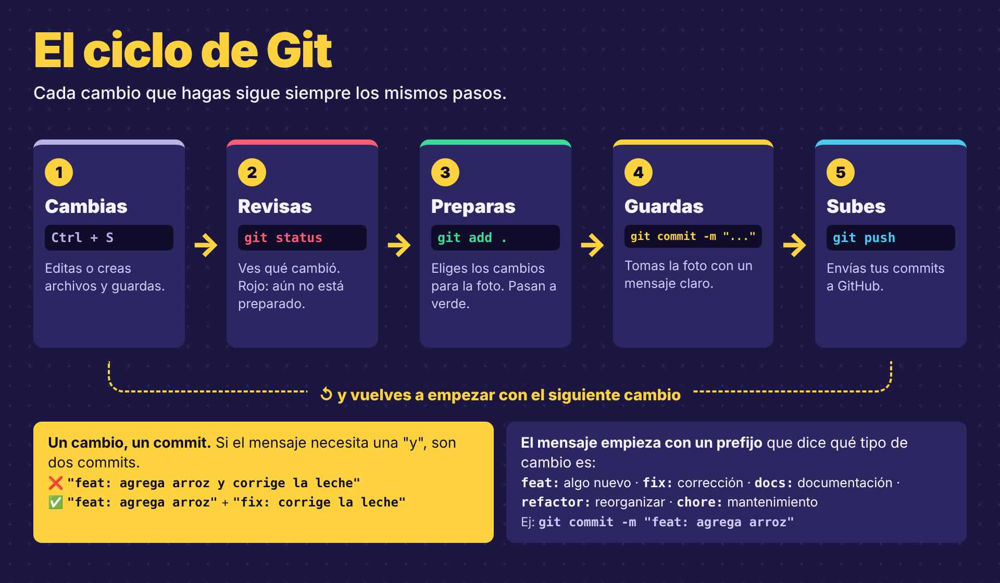

# 🛠️ oficio-dev

  

**Material práctico para aprender el oficio de desarrollar software: lo que se hace en un equipo real, explicado en español y listo para practicar.**

Un oficio se aprende haciendo. Aquí no hay teoría de relleno: cada guía termina en algo que funciona, y cada imagen explica una idea en un minuto.

---

## ¿Por qué este material?

| | |
|---|---|
| 🔧 **Práctico** | Cada guía se sigue paso a paso y termina en un resultado que puedes ver y mostrar |
| 👀 **Visual** | Imágenes pensadas para proyectar en clase o repasar antes de practicar |
| 🏢 **De industria** | Se trabaja como en un equipo real: ramas, Pull Requests, documentación y buenas prácticas |

---

## Contenido

### 📝 Markdown

| Recurso | Para qué sirve |
|---|---|
| [Guía de Markdown](markdown/Guia_Markdown.md) | Todo lo necesario para escribir un README profesional: títulos, tablas, código, alertas, insignias y una plantilla lista para usar |
| [Markdown en 1 minuto](markdown/Markdown_en_1_minuto.png) | Lo que escribes y cómo lo muestra GitHub, en una sola imagen |

### 🌿 Git y GitHub

| Recurso | Para qué sirve |
|---|---|
| [Las 3 zonas de Git](git/Las_3_zonas_de_Git.png) | Cómo viaja un cambio de tu carpeta al historial |
| [El ciclo de Git](git/El_ciclo_de_Git.png) | Los pasos que repites con cada cambio, y cómo escribir buenos mensajes de commit |
| [Cheatsheet de Git](git/Cheatsheet_Git.png) | Los comandos esenciales en una hoja |
| [Estructura del proyecto](git/Estructura_del_proyecto.png) | Cómo organizar un repositorio: carpetas, `.gitignore` y README |

  

---

## Cómo usar este repositorio

1. Dale ⭐ **Star** (arriba a la derecha): así lo tienes guardado en tu cuenta y sabes cuándo hay material nuevo.
2. Abre el recurso que necesites. Para descargar un archivo, entra a él y usa el botón **Download raw file**.
3. Las guías `.md` se leen mejor en VS Code: ábrelas y presiona **Ctrl + Shift + V**.

> [!TIP]
> ¿Quieres todo el material? Botón verde **Code → Download ZIP**.

---

## Autor

**Víctor Ibarbo** · Instructor Análisis y desarrollo de software ADSO · [GitHub](https://github.com/ibarbo)

## Licencia

[CC BY-NC 4.0](LICENSE): puedes usar, compartir y adaptar este material para aprender o enseñar, citando al autor. No se permite el uso comercial.
