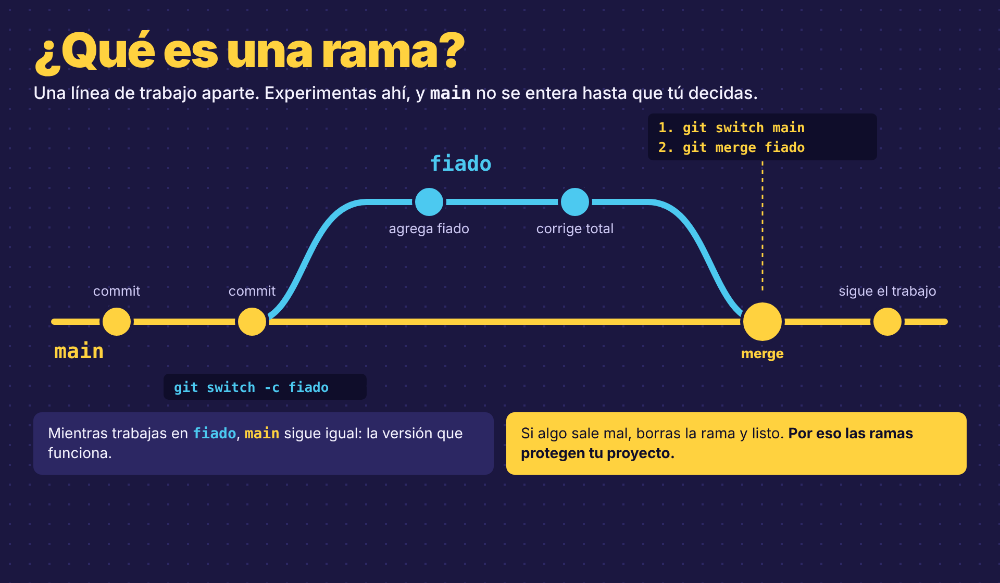
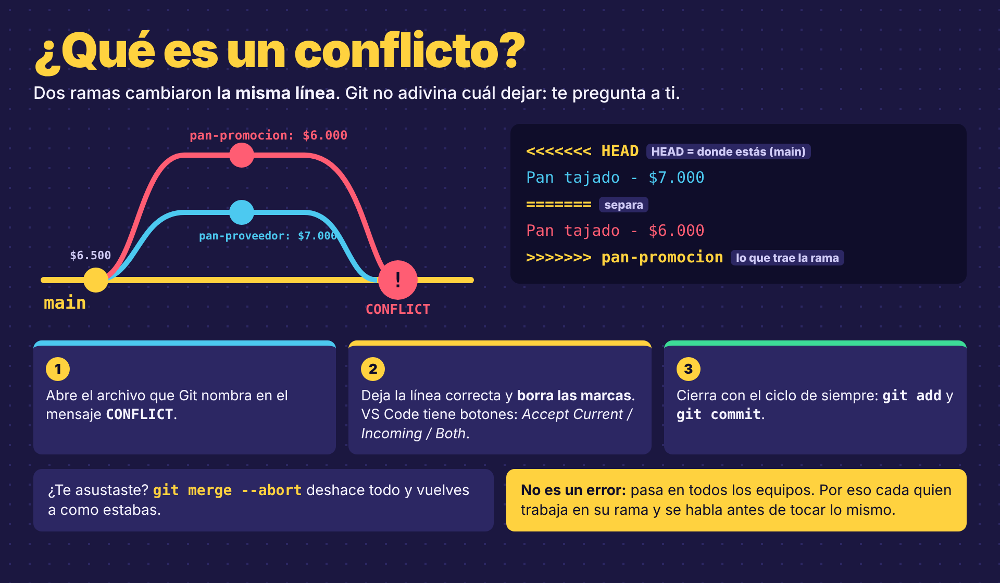

# Ramas: trabajar sin miedo

**Trabajo individual** · Repositorio `tienda-don-pedro`

> Don Pedro quiere cosas nuevas en su tienda, pero no quiere que nada se dañe mientras tanto. Para eso existen las ramas: trabajas aparte, pruebas lo que quieras, y solo cuando el cambio funciona lo juntas con `main`. Hoy lo hacemos paso a paso en grupo, y después cada quien por su cuenta.

## Qué se busca con esta actividad

- **Perderle el miedo a dañar el proyecto.** En una rama puedes equivocarte todo lo que quieras: `main` no se entera.
- **Entender qué pasa en cada momento.** Después de cada comando miramos lo que responde Git, porque ahí te dice dónde estás y qué hacer.
- **Resolver un conflicto con calma.** Pasa en todos los equipos, y se arregla en un minuto cuando sabes leerlo.

## Qué se entrega

| Cuándo | Qué | Dónde |
|---|---|---|
| Al terminar | El enlace de tu repositorio y un **pantallazo** de lo que muestra `git log --oneline --graph` en la consola | Donde te indique tu instructor |

---

## Antes de empezar

> [!NOTE]
> **¿No tienes la tienda?** Descarga [`tienda-don-pedro.zip`](tienda-don-pedro.zip), descomprímelo y, dentro de la carpeta: `git init`, crea una carpeta `datos`, mueve ahí los dos `.txt`, y haz `git add .` y `git commit -m "feat: primera versión de la tienda"`.

1. Abre Git Bash y entra a tu proyecto:
   ```
   cd tienda-don-pedro
   ```
2. Abre el proyecto en VS Code:
   ```
   code .
   ```
3. Revisa que todo esté guardado:
   ```
   git status
   ```
   **Debe salir:**
   ```
   On branch main
   nothing to commit, working tree clean
   ```
   Si te salen archivos en rojo o en verde, primero haz el commit de lo que tenías pendiente.

---

## Qué es una rama

Hasta ahora todos tus commits iban en una sola línea: `main`. Una **rama** es una línea de trabajo aparte que sale de `main`. Lo que haces ahí no toca `main` hasta que tú decidas juntarlo. Mira la imagen *¿Qué es una rama?*

<p align="center"></p>

**Para qué sirve:**
- **Probar sin miedo.** Si el cambio sale mal, borras la rama y `main` queda intacta.
- **Trabajar en equipo.** Cada persona trabaja en su propia rama, al mismo tiempo, sin pisarse.
- **Ordenar el trabajo.** Una rama por cada cosa: el fiado en una, los descuentos en otra.

**El ciclo de vida de una rama:**
```
crear  →  trabajar (commits)  →  juntar con main (merge)  →  borrar
```

**¿Por qué se borra al terminar?** Porque su trabajo ya quedó en `main`: la rama era solo el espacio para hacerlo. Si no se borran, se acumulan decenas de ramas viejas y nadie sabe cuáles siguen vivas. En los equipos profesionales, **una rama terminada es una rama borrada.** Borrarla no borra los commits: esos ya están en `main`.

---

## Parte 1: Tu primera rama (sígueme)

**Lo que pide Don Pedro:** *"Muchos clientes me compran fiado y lo anoto en un cuaderno. Quiero tenerlo en la tienda, pero no quiero dañar lo que ya funciona."*

**Cómo se trabaja esta parte:** en clase, el instructor escribe cada comando en el proyector y tú lo escribes en tu consola. Aquí tienes qué hacer, una pista y **lo que debe salir**, para comprobar que vas bien. Los comandos completos están en la tabla del final, por si te pierdes.

### Paso 1: ¿En qué rama estoy?

**Pista:** el comando que muestra las ramas es `git` seguido de la palabra *rama* en inglés.

**Debe salir:**
```
* main
```
Solo existe `main`. El asterisco `*` marca la rama en la que estás.

### Paso 2: Crea la rama `fiado` y cámbiate a ella

**Pista:** `git switch` cambia de rama, y la opción `-c` la crea antes de cambiarte.

**Debe salir:**
```
Switched to a new branch 'fiado'
```
Desde aquí, todo lo que hagas queda en `fiado`.

### Paso 3: Haz el cambio

En VS Code, dentro de la carpeta `datos`, crea el archivo `fiado.txt` con esto:
```
FIADO - TIENDA DON PEDRO

Doña Rosa - $12.000
```

### Paso 4: Revisa y guarda (el ciclo de siempre)

**Revisa** con el comando de siempre. **Debe salir:**
```
On branch fiado
Untracked files:
	datos/fiado.txt
```
Fíjate en la primera línea: **On branch fiado**. Git te recuerda dónde estás.

**Prepara y guarda** el archivo con el mensaje `feat: agrega registro de fiado`. **Debe salir:**
```
[fiado 274c4cf] feat: agrega registro de fiado
 1 file changed, 3 insertions(+)
```
Entre corchetes aparece `fiado`: el commit quedó en tu rama. El código (`274c4cf`) será distinto en tu computador.

### Paso 5: El momento mágico

**Vuelve a `main`** (pista: `git switch` sin la `-c`, porque la rama ya existe).

Ahora mira la carpeta `datos` en VS Code. **¿Dónde está `fiado.txt`?**

No está. `main` sigue exactamente como antes. El archivo no se borró: vive en la rama `fiado`. **Vuelve a `fiado`** y mira otra vez la carpeta: ahí está. **Eso es una rama:** dos versiones del proyecto que no se pisan.

### Paso 6: Junta la rama con `main` (merge)

Don Pedro revisó el fiado y le gustó. Hay que pasarlo a `main`. **Siempre te paras en la rama que recibe:** primero te cambias a `main`, y desde ahí juntas `fiado`.

**Pista:** el comando para juntar es `git merge` seguido del nombre de la rama que llega.

**Debe salir:**
```
Updating 8e876a3..274c4cf
Fast-forward
 datos/fiado.txt | 3 +++
 1 file changed, 3 insertions(+)
```

**¿Qué es `Fast-forward`?** Significa "adelantar". Mientras trabajabas en `fiado`, `main` no cambió. Entonces Git no tiene nada que mezclar: solo adelanta `main` hasta donde llegó tu rama, como cuando adelantas un video. No se crea ningún commit nuevo. Más adelante, en el conflicto, vas a ver el caso contrario: cuando `main` sí cambió, Git tiene que mezclar y crea un commit de merge.

### Paso 7: Borra la rama que ya terminaste

**Pista:** `git branch` con la opción `-d` (de *delete*, borrar) y el nombre de la rama.

**Debe salir:**
```
Deleted branch fiado (was 274c4cf).
```
El trabajo no se pierde: ya está en `main`. La `-d` solo borra ramas que ya están juntadas; si no lo están, Git te avisa y no borra nada.

---

## Parte 2: Ahora por tu cuenta

Repite lo de la Parte 1 para cada Sprint: **crear la rama, hacer el cambio, commit, volver a `main`, merge y borrar la rama.** Los comandos los escribes tú. Guíate por la imagen *¿Qué es una rama?* y por la tabla de comandos del final.

### Sprint 1: Descuentos
*"Quiero dar descuentos a mis clientes frecuentes."*

- Rama: `descuentos`
- Crea `datos/descuentos.txt` con un título y al menos dos clientes con su descuento. Por ejemplo: `Doña Rosa - 10%`.
- Mensaje: `feat: agrega descuentos para clientes frecuentes`

### Sprint 2: Domicilios
*"Ahora también llevo pedidos a la casa. Que se sepa en la portada."*

- Rama: `domicilios`
- En el `README.md`, agrega una sección **Domicilios** con el horario y el barrio que cubre la tienda (invéntalos).
- Mensaje: `docs: agrega sección de domicilios al README`

**Antes de hacer el merge**, cámbiate a `main` y abre el README: la sección no debe estar. Vuelve a la rama y ahí sí aparece. Compruébalo.

---

## Parte 3: El conflicto (sígueme)

**En clase, esta parte se hace todos al tiempo**, con el proyector. Si no terminaste los Sprints, los terminas después.

Un conflicto pasa cuando **dos ramas cambian la misma línea** y Git no sabe con cuál quedarse. No es un error: es Git preguntándote. Mira la imagen *¿Qué es un conflicto?*

<p align="center"></p>

**La situación:** el proveedor subió el pan, pero al mismo tiempo alguien quiso ponerlo en promoción. Cada cambio se hizo en su rama.

### Paso 1: Primera rama, el pan sube

1. Crea la rama `pan-proveedor` y cámbiate a ella.
2. En `datos/productos.txt`, cambia el precio del pan a `$7.000` y guarda.
3. Haz el commit con el mensaje `fix: sube el precio del pan`.
4. Vuelve a `main`.

### Paso 2: Segunda rama, el pan en promoción

Desde `main`, que todavía tiene el precio viejo:
1. Crea la rama `pan-promocion` y cámbiate a ella.
2. En `datos/productos.txt`, cambia el precio del pan a `$6.000` y guarda.
3. Haz el commit con el mensaje `feat: pan en promoción`.
4. Vuelve a `main`.

### Paso 3: Junta la primera rama

Desde `main`, junta `pan-proveedor`. Sale `Fast-forward`, sin problema: el pan ya cuesta `$7.000` en `main`.

### Paso 4: Junta la segunda… y aparece el conflicto

Desde `main`, junta `pan-promocion`. **Debe salir:**
```
Auto-merging datos/productos.txt
CONFLICT (content): Merge conflict in datos/productos.txt
Automatic merge failed; fix conflicts and then commit the result.
```
Sin pánico: Git te dice exactamente qué archivo tiene el conflicto y qué hacer: arreglarlo y hacer commit.

### Paso 5: Lee el conflicto

Abre `datos/productos.txt` en VS Code. Vas a ver esto:
```
<<<<<<< HEAD
Pan tajado - $7.000
=======
Pan tajado - $6.000
>>>>>>> pan-promocion
```

| Marca | Qué significa |
|---|---|
| `<<<<<<< HEAD` | Empieza lo que tiene la rama donde estás parado. **HEAD** es como Git dice "donde estás": aquí, `main` |
| `=======` | Separa las dos versiones |
| `>>>>>>> pan-promocion` | Termina lo que trae la rama `pan-promocion` |

### Paso 6: Decide y resuelve

Don Pedro decide: **el precio del proveedor gana.** Deja solo esta línea y borra las marcas y la otra versión:
```
Pan tajado - $7.000
```
VS Code te ayuda con unos botones encima del conflicto: **Accept Current Change** deja la de `main`, **Accept Incoming Change** deja la de la rama y **Accept Both Changes** deja las dos. Aquí, *Accept Current Change*.

Guarda el archivo y cierra el conflicto con el ciclo de siempre: prepara el archivo y haz el commit con el mensaje `fix: resuelve conflicto del precio del pan`.

Este commit es el **commit de merge**: el que junta las dos versiones. Es lo contrario del `Fast-forward`.

### Paso 7: Borra las dos ramas

Borra `pan-proveedor` y `pan-promocion`, como hiciste con `fiado`.

---

## Mira tu historia

```
git log --oneline --graph
```
**Debe salir algo así:**
```
*   b0bf9bb fix: resuelve conflicto del precio del pan
|\
| * 7ef4260 feat: pan en promoción
* | faff21f fix: sube el precio del pan
|/
* 274c4cf feat: agrega registro de fiado
```
Ahí se ven las dos ramas del pan separándose y volviéndose a juntar. **Toma un pantallazo de la consola** con este gráfico: va en la entrega.

## Sube todo

```
git push
```

---

## Los comandos de ramas

| Comando | Qué hace |
|---|---|
| `git branch` | Muestra las ramas; el `*` marca dónde estás |
| `git switch -c nombre` | Crea una rama y te cambia a ella |
| `git switch nombre` | Te cambia a una rama que ya existe |
| `git merge nombre` | Junta esa rama con la rama donde estás parado |
| `git branch -d nombre` | Borra una rama que ya está juntada |
| `git log --oneline --graph` | Muestra la historia con sus ramas |

## Si te sale este problema

| Problema | Qué hacer |
|---|---|
| `error: Your local changes would be overwritten` al cambiar de rama | Tienes cambios sin guardar. Haz el commit antes de cambiarte |
| `fatal: a branch named 'fiado' already exists` | Esa rama ya existe. Cámbiate con `git switch fiado`, sin la `-c` |
| `error: The branch 'x' is not fully merged` | La rama tiene trabajo que no está en `main`. Haz el merge primero |
| Me asusté en medio del conflicto | `git merge --abort` deshace el merge y todo vuelve a como estaba |

## Antes de entregar, revisa

- [ ] `git branch` muestra solo `main`: todas las ramas quedaron juntadas y borradas.
- [ ] En `main` están `fiado.txt`, `descuentos.txt` y la sección Domicilios en el README.
- [ ] El pan cuesta `$7.000` y el archivo no tiene marcas `<<<<<<<`.
- [ ] Hice `git push` y en GitHub se ve todo.
- [ ] Tomé el pantallazo de `git log --oneline --graph`.
